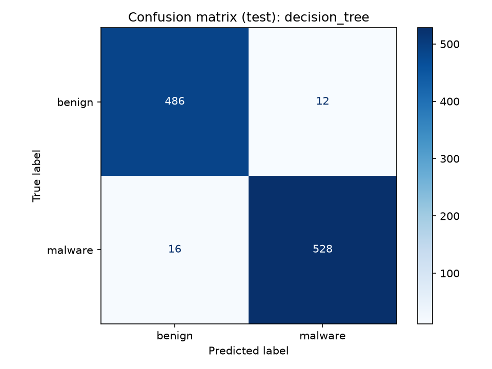
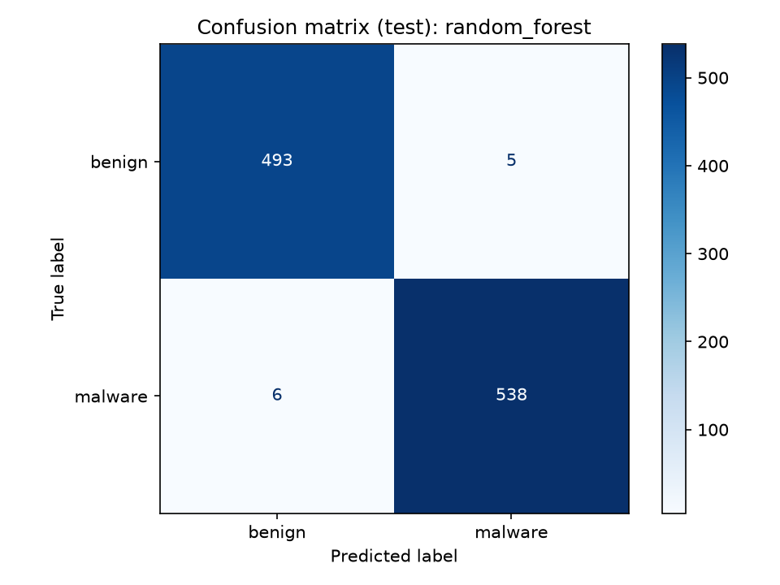
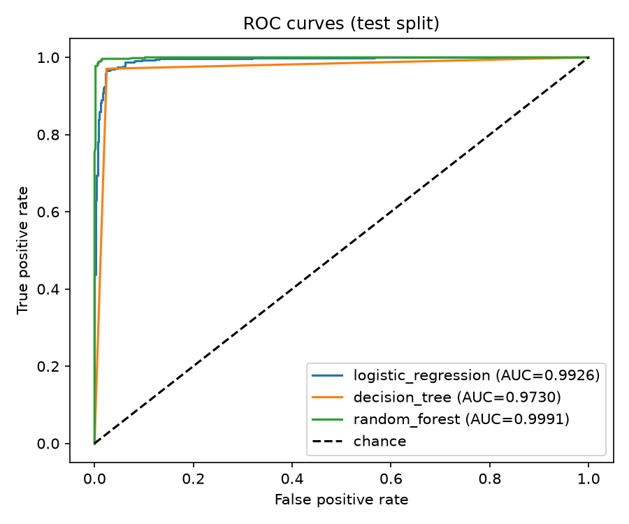
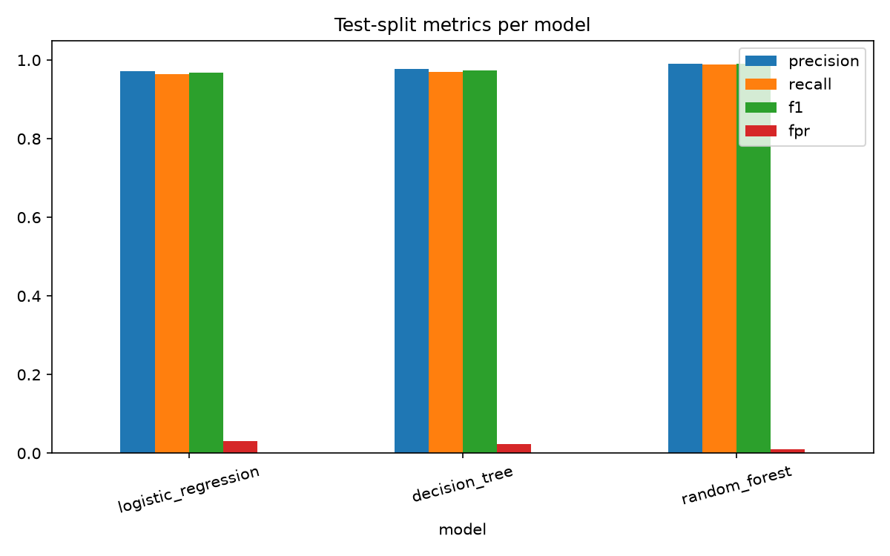
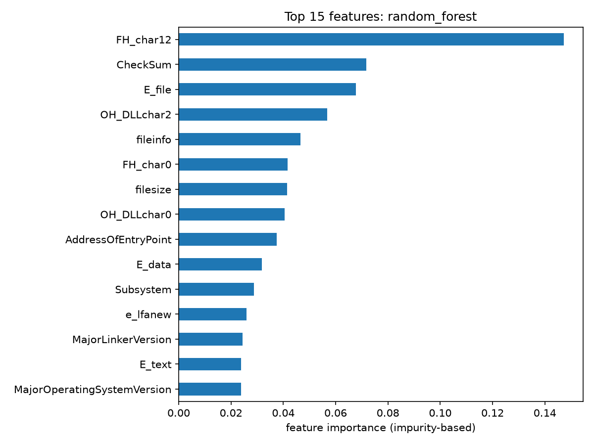
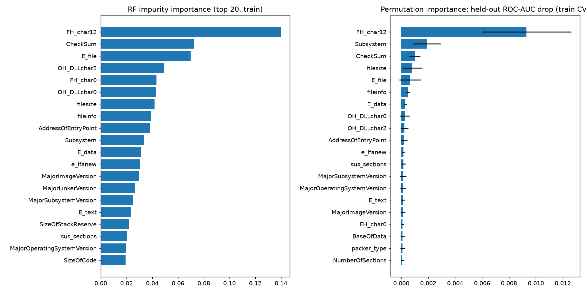

# Machine-Learning-Based Classification of Executable Files Using Static Analysis

A student lab project. All numbers below are copied from the files in `outputs/`; nothing is estimated.

## 1. Aim

To train and compare three machine-learning models (Logistic Regression, Decision Tree, Random Forest) that classify Windows PE files as benign (0) or malicious (1), using only statically extracted PE-header features, and to evaluate them honestly (single held-out test set, cross-validation for all tuning, false-positive rate reported alongside accuracy-type metrics).

Only a pre-extracted feature CSV was used. No malware binary was downloaded, unpacked or run.

## 2. Dataset

- Source: ClaMP (`ClaMP_Integrated-5184.csv`), 69 PE-header features plus the label `class` (1 = malware, 0 = benign). The file name says 5184, but the file actually has **5,210 rows** (and 70 columns including `class`).
- Raw class balance: 2,722 malware, 2,488 benign.
- No missing values were found. 3 exact duplicate rows were removed, and no feature-identical rows with conflicting labels were found, leaving **5,207 samples** (2,719 malware, 2,488 benign).
- `packer_type` is the only text column (40 distinct values; `NoPacker` is the most common with 4,393 rows). `fileinfo` loaded as a numeric 0/1 column in this copy of the file, so no coercion was needed.
- One stratified 80/20 split (`random_state=42`), saved to `data/` and reused by every later step:

| Split | Rows | Malware | Benign |
|---|---|---|---|
| Train | 4,165 | 2,175 | 1,990 |
| Test | 1,042 | 544 | 498 |

## 3. Features

The 69 original columns fall into these themes (counts from `outputs/feature_analysis.txt`):

| Theme | Columns |
|---|---|
| DOS header | 6 |
| Entropy (`E_text`, `E_data`, `E_file`) | 3 |
| File header (incl. `NumberOfSections`, `CreationYear`, `FH_char0`-`FH_char14`) | 17 |
| File-level (`filesize`, `fileinfo`) | 2 |
| Optional header: DLL characteristics (`OH_DLLchar0`-`10`) | 11 |
| Optional header: sizes / addresses / alignment | 14 |
| Optional header: stack / heap sizes | 4 |
| Optional header: versions | 8 |
| Packer (`packer`, `packer_type`) | 2 |
| Section counts (`sus_sections`, `non_sus_sections`) | 2 |

The feature analysis was done on the training split only. **58 of the 69 columns were kept and 11 were dropped**, each for one reason:

- 9 columns are constant in the training split: `FH_char1`, `FH_char11`, `FH_char13`, `SectionAlignment`, `FileAlignment`, `OH_DLLchar5`, `OH_DLLchar6`, `OH_DLLchar9`, `OH_DLLchar10`. (On the full data set 8 columns are constant; `OH_DLLchar9` is constant only within the training split.)
- `FH_char10`: exact duplicate of `FH_char9`.
- `FH_char14`: near-duplicate of `FH_char6` (differs in 1 of 4,165 rows, r = 0.9978).

Some other highly correlated pairs (`e_cp`, `e_cparhdr`, `SizeOfCode`, `SizeOfInitializedData`, Pearson > 0.99) were kept: the correlation is driven by a few extreme rows and their Spearman correlation is low. `FH_char3` (r = 0.97 with `FH_char2`) and `packer` (equal to `packer_type != NoPacker`) were also kept.

`packer_type` is one-hot encoded inside the model pipeline (fit on train only, unknown values ignored). After encoding, the models see 94 input columns.

**Features not available in this dataset.** The ClaMP file contains only the 69 header-derived columns above. Features that are often listed for static malware classification, such as the number of imported functions, the number of imported DLLs / the import table contents, per-section details, strings, or opcode features, are **not** present, so they could not be used.

## 4. Methodology

1. `src/prepare_data.py`: load, check types, remove duplicates, descriptive EDA, then ONE stratified 80/20 split (seed 42).
2. `src/analyze_features.py`: feature analysis on the train split only (constant / duplicate / correlated columns, single-feature separators, RF impurity and permutation importance, ablation). It writes `outputs/selected_features.txt`.
3. `src/train_models.py`: `GridSearchCV` with stratified 5-fold CV on the train split only, refit on F1. Scalers and encoders live inside the pipelines, so they are fit on training folds only.
4. `src/evaluate_models.py`: loads the saved models and opens the test split **once**, with no tuning or retraining. The best model was chosen by cross-validated F1 on train, not by the test score.

Seed 42 is used everywhere. A majority-class baseline (predict the train-majority class, malware, for every file) is included for reference.

## 5. Models

| Model | Setup | Best parameters (from CV) |
|---|---|---|
| Logistic Regression | `Pipeline`: StandardScaler on numeric columns + one-hot `packer_type`, then LogisticRegression (`max_iter=5000`) | `C = 100` (grid: 0.01, 0.1, 1, 10, 100) |
| Decision Tree | one-hot `packer_type`, no scaling | `criterion = entropy`, `max_depth = 12`, `min_samples_leaf = 1` (40 candidates) |
| Random Forest | one-hot `packer_type`, no scaling | `n_estimators = 300`, `max_depth = None`, `min_samples_leaf = 1`, `max_features = sqrt` (36 candidates) |

## 6. Results

### 6.1 Cross-validation (5-fold on the train split, mean +/- std)

| Model | F1 | ROC-AUC | Precision | Recall |
|---|---|---|---|---|
| Logistic Regression | 0.9651 +/- 0.0044 | 0.9914 +/- 0.0019 | 0.9656 +/- 0.0099 | 0.9646 +/- 0.0063 |
| Decision Tree | 0.9783 +/- 0.0058 | 0.9783 +/- 0.0068 | 0.9793 +/- 0.0029 | 0.9775 +/- 0.0101 |
| Random Forest | 0.9917 +/- 0.0042 | 0.9995 +/- 0.0005 | 0.9886 +/- 0.0051 | 0.9949 +/- 0.0057 |

### 6.2 Test split (1,042 files: 544 malware, 498 benign)

FPR = FP / (FP + TN). Malware is the positive class.

| Model | Precision | Recall | F1 | FPR | ROC-AUC | TN | FP | FN | TP | Accuracy |
|---|---|---|---|---|---|---|---|---|---|---|
| Logistic Regression | 0.9722 | 0.9651 | 0.9686 | 0.0301 | 0.9926 | 483 | 15 | 19 | 525 | 0.9674 |
| Decision Tree | 0.9778 | 0.9706 | 0.9742 | 0.0241 | 0.9730 | 486 | 12 | 16 | 528 | 0.9731 |
| Random Forest | 0.9908 | 0.9890 | 0.9899 | 0.0100 | 0.9991 | 493 | 5 | 6 | 538 | 0.9894 |
| Majority baseline | 0.5221 | 1.0000 | 0.6860 | 1.0000 | 0.5000 | 0 | 498 | 0 | 544 | 0.5221 |

### 6.3 F1 at each stage

"Train" is the mean F1 over the CV training folds at the chosen parameters.

| Model | Train | CV | Test | Test - CV |
|---|---|---|---|---|
| Logistic Regression | 0.9719 | 0.9651 | 0.9686 | +0.0036 |
| Decision Tree | 0.9989 | 0.9783 | 0.9742 | -0.0042 |
| Random Forest | 1.0000 | 0.9917 | 0.9899 | -0.0019 |

The Decision Tree and Random Forest fit the training folds almost perfectly (train-minus-CV F1 gap 0.0206 and 0.0083 respectively; Logistic Regression 0.0069). Test F1 is close to CV F1 for all three models, which suggests the CV estimate was reasonable on this split; it does not rule out dataset-level problems (see Limitations).

### 6.4 Plots

Confusion matrices (test split):

ROC curves (test split):

Model comparison (precision, recall, F1, FPR on the test split):

Feature importance of the best model (Random Forest, top 15, impurity-based):

In that plot the highest-ranked features are `FH_char12`, `CheckSum`, `E_file`, `OH_DLLchar2` and `fileinfo`. Importance describes what the model uses, not what makes a file malicious.

Train-only feature analysis (RF impurity and permutation importance, from `analyze_features.py`):

## 7. Comparison and discussion

- **Best model: Random Forest**, chosen by cross-validated F1 on the training split (0.9917 +/- 0.0042) before the test set was opened. On the test split it also had the best precision, recall, F1, FPR and ROC-AUC of the three models.
- Ranking was the same on CV F1 and test F1: Random Forest, then Decision Tree, then Logistic Regression. Logistic Regression has a higher test ROC-AUC (0.9926) than the Decision Tree (0.9730).
- All three models are far above the majority baseline (test F1 0.6860, accuracy 0.5221, ROC-AUC 0.5).
- **Cost of false positives.** A false positive is a benign file flagged as malware. In use this would mean blocked or quarantined legitimate software, wasted analyst time and, over time, alert fatigue. A false negative lets malware through and is usually costlier per event, but FPR still matters because benign files greatly outnumber malware in real traffic. On this test set the Random Forest produced 5 false positives out of 498 benign files (FPR 0.0100), the Decision Tree 12 (0.0241) and Logistic Regression 15 (0.0301). Because this dataset is close to balanced, these FPR values are not what a real deployment would see.
- The test set is small (1,042 files), so a single extra error moves the metrics noticeably. The differences between Decision Tree and Logistic Regression in particular are small and should not be over-interpreted; no significance test was run.

## 8. Limitations

- **Single split.** One 80/20 split and one test set. There is no repeated-split or repeated-CV estimate of variance on the test side.
- **Near-balanced classes.** The test set has 544 malware and 498 benign files. Real-world malware prevalence is much lower, so precision and FPR here are optimistic.
- **Header-only features.** Only static PE-header features were used. Import counts / imported-DLL features are not in this dataset (see Section 3), and no behavioural or code-level features were available.
- **Dataset source artefacts.** Benign and malware files may come from different collection sources, so models can learn artefacts of how the data was collected instead of malicious behaviour. Examples in the data: `fileinfo` has a mean of 0.8101 for benign and 0.2970 for malware in the training split, and `CheckSum` was the strongest single-feature separator in the analysis (single-feature depth-3 tree CV AUC 0.8134). Both `fileinfo` and `CheckSum` also rank high in the Random Forest importance.
- **Ablation on suspect columns.** To check whether the suspect columns drive the result, 5-fold CV on the train split (default hyperparameters, `outputs/feature_ablation_cv_train.csv`) was repeated with them removed. Removing them lowered CV F1 only slightly:

  | Feature set | Columns | RF F1 | RF ROC-AUC | DT F1 | DT ROC-AUC |
  |---|---|---|---|---|---|
  | A: all non-constant columns | 60 | 0.9917 | 0.9995 | 0.9747 | 0.9736 |
  | B: without `fileinfo`, `packer`, `packer_type`, `sus_sections`, `non_sus_sections`, `CreationYear` | 54 | 0.9888 | 0.9993 | 0.9706 | 0.9692 |
  | C: without `fileinfo` | 59 | 0.9881 | 0.9993 | 0.9715 | 0.9702 |
  | D: without `packer`, `packer_type` | 58 | 0.9904 | 0.9995 | 0.9758 | 0.9749 |
  | E: without `sus_sections`, `non_sus_sections` | 58 | 0.9915 | 0.9992 | 0.9755 | 0.9746 |

  So the models do not depend on any single one of these columns, but this does not show that the remaining columns are free of collection artefacts. The ablation used the 60 non-constant columns, not the final 58 (it still contained `FH_char10` and `FH_char14`), and it was only run for RF and DT, not Logistic Regression.
- **Dataset age.** ClaMP is an older research dataset; current malware and benign software may look different in their headers.
- **Packing / obfuscation / evasion.** Packed, obfuscated or header-forged files and adversarial samples were not tested. An attacker who knows the features could change header fields.
- **High scores do not imply real-world performance.** The near-perfect scores come from a clean, near-balanced, research-grade dataset and a single split, and should not be read as expected performance on real traffic.
- **Importances are descriptive.** Impurity-based importance and permutation importance describe model behaviour, not causes, and correlated features share importance.
- **Tuning scope.** Hyperparameters were tuned by CV on the train split only; the grids were small and the test split was not used for any choice.

## 9. Conclusion

On the ClaMP header features, a Random Forest chosen by cross-validation reached test F1 0.9899, test ROC-AUC 0.9991 and 5 false positives out of 498 benign files, ahead of the Decision Tree (F1 0.9742) and Logistic Regression (F1 0.9686) and far above the majority baseline (F1 0.6860). The ablation suggests the result is not tied to one suspect column, but the data is near-balanced, header-only, old and possibly affected by collection artefacts, and only one split was evaluated. These results show the approach works on this dataset; they are not evidence of how the models would perform on real-world files.
