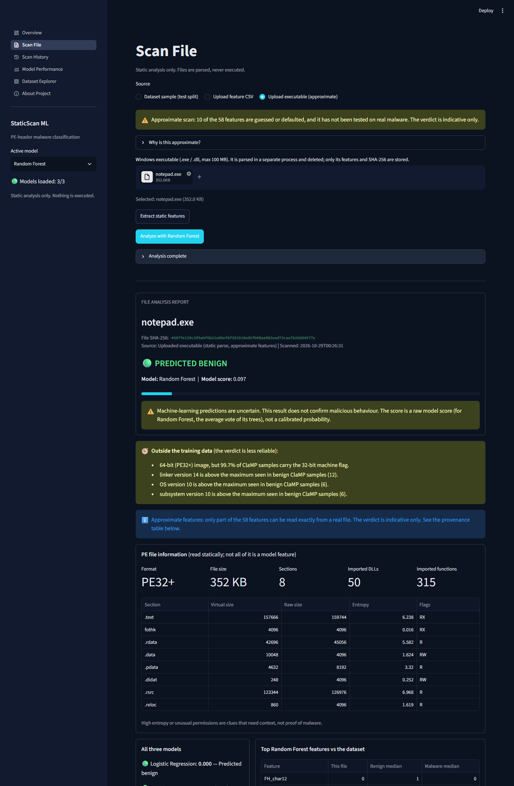
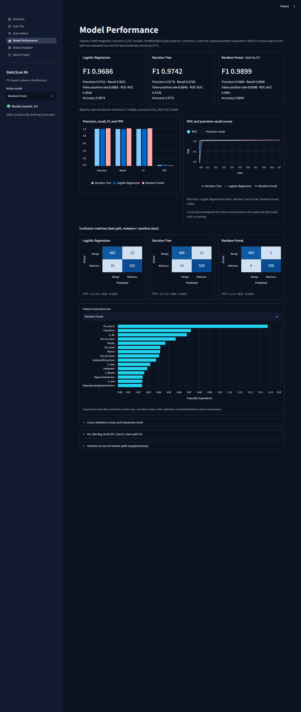

# Machine-Learning-Based Classification of Executable Files Using Static Analysis

A student lab project. All numbers below are copied from the files in `outputs/`; nothing is estimated.

## 1. Aim

To train and compare three machine-learning models (Logistic Regression, Decision Tree, Random Forest) that classify Windows PE files as benign (0) or malicious (1), using only statically extracted PE-header features, and to evaluate them honestly (single held-out test set, cross-validation for all tuning, false-positive rate reported alongside accuracy-type metrics).

Training, tuning and evaluation used only a pre-extracted feature CSV. No malware binary was downloaded, unpacked or run. The optional demo dashboard can also statically parse an uploaded Windows executable (see Section 6.6); parsing never executes the file.

## 2. Dataset

- Source: ClaMP (`ClaMP_Integrated-5184.csv`), 69 PE-header features plus the label `class` (1 = malware, 0 = benign). The file name says 5184, but the file actually has **5,210 rows** (and 70 columns including `class`).
- Raw class balance: 2,722 malware, 2,488 benign.
- No missing values were found. 3 exact duplicate rows were removed, and no feature-identical rows with conflicting labels were found, leaving **5,207 samples** (2,719 malware, 2,488 benign).
- `packer_type` is the only text column (40 distinct values; `NoPacker` is the most common with 4,393 rows). `fileinfo` loaded as a numeric 0/1 column in this copy of the file, so no coercion was needed.
- One stratified 80/20 split (`random_state=42`), saved to `data/` and reused by every later step:

| Split | Rows | Malware | Benign |
|---|---|---|---|
| Train | 4,165 | 2,175 | 1,990 |
| Test | 1,042 | 544 | 498 |

## 3. Features

The 69 original columns fall into these themes (counts from `outputs/feature_analysis.txt`):

| Theme | Columns |
|---|---|
| DOS header | 6 |
| Entropy (`E_text`, `E_data`, `E_file`) | 3 |
| File header (incl. `NumberOfSections`, `CreationYear`, `FH_char0`-`FH_char14`) | 17 |
| File-level (`filesize`, `fileinfo`) | 2 |
| Optional header: DLL characteristics (`OH_DLLchar0`-`10`) | 11 |
| Optional header: sizes / addresses / alignment | 14 |
| Optional header: stack / heap sizes | 4 |
| Optional header: versions | 8 |
| Packer (`packer`, `packer_type`) | 2 |
| Section counts (`sus_sections`, `non_sus_sections`) | 2 |

The feature analysis was done on the training split only. **58 of the 69 columns were kept and 11 were dropped**, each for one reason:

- 9 columns are constant in the training split: `FH_char1`, `FH_char11`, `FH_char13`, `SectionAlignment`, `FileAlignment`, `OH_DLLchar5`, `OH_DLLchar6`, `OH_DLLchar9`, `OH_DLLchar10`. (On the full data set 8 columns are constant; `OH_DLLchar9` is constant only within the training split.)
- `FH_char10`: exact duplicate of `FH_char9`.
- `FH_char14`: near-duplicate of `FH_char6` (differs in 1 of 4,165 rows, r = 0.9978).

Some other highly correlated pairs (`e_cp`, `e_cparhdr`, `SizeOfCode`, `SizeOfInitializedData`, Pearson > 0.99) were kept: the correlation is driven by a few extreme rows and their Spearman correlation is low. `FH_char3` (r = 0.97 with `FH_char2`) and `packer` (equal to `packer_type != NoPacker`) were also kept.

`packer_type` is one-hot encoded inside the model pipeline (fit on train only, unknown values ignored). After encoding, the models see 94 input columns.

**Features not available in this dataset.** The ClaMP file contains only the 69 header-derived columns above. Features that are often listed for static malware classification, such as the number of imported functions, the number of imported DLLs / the import table contents, per-section details, strings, or opcode features, are **not** present, so they could not be used.

## 4. Methodology

1. `src/prepare_data.py`: load, check types, remove duplicates, descriptive EDA, then ONE stratified 80/20 split (seed 42).
2. `src/analyze_features.py`: feature analysis on the train split only (constant / duplicate / correlated columns, single-feature separators, RF impurity and permutation importance, ablation). It writes `outputs/selected_features.txt`.
3. `src/train_models.py`: `GridSearchCV` with stratified 5-fold CV on the train split only, refit on F1. Scalers and encoders live inside the pipelines, so they are fit on training folds only.
4. `src/evaluate_models.py`: loads the saved models and opens the test split **once**, with no tuning or retraining. The best model was chosen by cross-validated F1 on train, not by the test score.

Seed 42 is used everywhere. A majority-class baseline (predict the train-majority class, malware, for every file) is included for reference.

## 5. Models

| Model | Setup | Best parameters (from CV) |
|---|---|---|
| Logistic Regression | `Pipeline`: StandardScaler on numeric columns + one-hot `packer_type`, then LogisticRegression (`max_iter=5000`) | `C = 100` (grid: 0.01, 0.1, 1, 10, 100) |
| Decision Tree | one-hot `packer_type`, no scaling | `criterion = entropy`, `max_depth = 12`, `min_samples_leaf = 1` (40 candidates) |
| Random Forest | one-hot `packer_type`, no scaling | `n_estimators = 300`, `max_depth = None`, `min_samples_leaf = 1`, `max_features = sqrt` (36 candidates) |

## 6. Results

### 6.1 Cross-validation (5-fold on the train split, mean +/- std)

| Model | F1 | ROC-AUC | Precision | Recall |
|---|---|---|---|---|
| Logistic Regression | 0.9651 +/- 0.0044 | 0.9914 +/- 0.0019 | 0.9656 +/- 0.0099 | 0.9646 +/- 0.0063 |
| Decision Tree | 0.9783 +/- 0.0058 | 0.9783 +/- 0.0068 | 0.9793 +/- 0.0029 | 0.9775 +/- 0.0101 |
| Random Forest | 0.9917 +/- 0.0042 | 0.9995 +/- 0.0005 | 0.9886 +/- 0.0051 | 0.9949 +/- 0.0057 |

### 6.2 Test split (1,042 files: 544 malware, 498 benign)

FPR = FP / (FP + TN). Malware is the positive class.

| Model | Precision | Recall | F1 | FPR | ROC-AUC | TN | FP | FN | TP | Accuracy |
|---|---|---|---|---|---|---|---|---|---|---|
| Logistic Regression | 0.9722 | 0.9651 | 0.9686 | 0.0301 | 0.9926 | 483 | 15 | 19 | 525 | 0.9674 |
| Decision Tree | 0.9778 | 0.9706 | 0.9742 | 0.0241 | 0.9730 | 486 | 12 | 16 | 528 | 0.9731 |
| Random Forest | 0.9908 | 0.9890 | 0.9899 | 0.0100 | 0.9991 | 493 | 5 | 6 | 538 | 0.9894 |
| Majority baseline | 0.5221 | 1.0000 | 0.6860 | 1.0000 | 0.5000 | 0 | 498 | 0 | 544 | 0.5221 |

### 6.3 F1 at each stage

"Train" is the mean F1 over the CV training folds at the chosen parameters.

| Model | Train | CV | Test | Test - CV |
|---|---|---|---|---|
| Logistic Regression | 0.9719 | 0.9651 | 0.9686 | +0.0036 |
| Decision Tree | 0.9989 | 0.9783 | 0.9742 | -0.0042 |
| Random Forest | 1.0000 | 0.9917 | 0.9899 | -0.0019 |

The Decision Tree and Random Forest fit the training folds almost perfectly (train-minus-CV F1 gap 0.0206 and 0.0083 respectively; Logistic Regression 0.0069). Test F1 is close to CV F1 for all three models, which suggests the CV estimate was reasonable on this split; it does not rule out dataset-level problems (see Limitations).

### 6.4 Plots

Confusion matrices (test split):

ROC curves (test split):

Model comparison (precision, recall, F1, FPR on the test split):

Feature importance of the best model (Random Forest, top 15, impurity-based):

In that plot the highest-ranked features are `FH_char12`, `CheckSum`, `E_file`, `OH_DLLchar2` and `fileinfo`. Importance describes what the model uses, not what makes a file malicious.

Train-only feature analysis (RF impurity and permutation importance, from `analyze_features.py`):

### 6.5 Robustness check (train split only, CV)

After the test evaluation, a further check was run with cross-validation on the train split only (`src/robustness_cv.py`, 5-fold CV repeated 3 times, mean +/- std of F1). The test split was not used again. Each model keeps the hyperparameters tuned earlier on all 58 features; only the input columns change.

| Feature set | Logistic Regression | Decision Tree | Random Forest |
|---|---|---|---|
| All 58 columns | 0.9634 +/- 0.0042 | 0.9780 +/- 0.0043 | 0.9908 +/- 0.0034 |
| without `fileinfo` | 0.9632 +/- 0.0057 | 0.9773 +/- 0.0048 | 0.9895 +/- 0.0033 |
| without `CheckSum` | 0.9627 +/- 0.0044 | 0.9746 +/- 0.0048 | 0.9883 +/- 0.0034 |
| without `fileinfo`, `CheckSum` | 0.9626 +/- 0.0054 | 0.9720 +/- 0.0047 | 0.9875 +/- 0.0037 |
| without `fileinfo`, `CheckSum`, `filesize` | 0.9515 +/- 0.0058 | 0.9692 +/- 0.0063 | 0.9845 +/- 0.0042 |

Removing the two columns suspected of being collection artefacts lowers Random Forest F1 by 0.0033 (0.9908 to 0.9875); removing `filesize` as well lowers it by 0.0063 in total. Logistic Regression is hit hardest by dropping all three (down 0.0119), so the models do use file-level metadata to some extent. This shows that no single one of these columns carries the result; it does not show that the dataset is free of collection bias, since other header fields could carry the same signal.

Logistic Regression picked `C = 100`, the largest value in the original grid. Extending the grid (same repeated CV) gave F1 of 0.9618 (`C = 1`), 0.9623 (10), 0.9634 (100), 0.9633 (1,000), 0.9632 (10,000) and 0.9633 (100,000), so the score is flat beyond `C = 100` and the original choice cost nothing. The final models were not changed.

### 6.6 Scanning real files in the dashboard (approximate, not part of the evaluation)

The dashboard (`src/app.py`) can statically parse an uploaded Windows executable with `pefile` (`src/pe_extract.py`) and feed the extracted features to the trained models. This is a demonstration feature and **not** part of the evaluation above. It is approximate because the ClaMP feature definitions are only partly documented. Of the 58 model features, 31 are read directly (header values, entropy, file size), 17 are bit flags whose bit order was inferred from the data (`FH_char*`, `OH_DLLchar*`), 8 are derived 0/1 flags whose exact definition is a best guess (`fileinfo`, `CreationYear`, `ImageBase`, `SizeOfImage`, `SizeOfHeaders`, `LoaderFlags`, `sus_sections`, `non_sus_sections`), and 2 are not checked and set to defaults (`packer`, `packer_type`). Every report shows the origin of each feature and warns when a file looks unlike the training data (for example 64-bit images, newer linker or OS versions).

**What was tested.** `src/probe_benign_files.py` ran the extractor and models on programs already installed on this PC, assumed to be benign but not verified (`outputs/real_file_probe.txt`):

| Sample | Parsed | Logistic Regression flagged | Decision Tree flagged | Random Forest flagged (highest score) |
|---|---|---|---|---|
| `.exe` files | 62 | 4 | 1 | 0 (0.473) |
| `.dll` files | 60 | 3 | 0 | 0 (0.333) |

Most of these files are 64-bit and built with toolchains far newer than the ClaMP samples, so the "outside training data" warnings apply to them. No malware was obtained, so **detection on real malware was not tested**, and nothing here shows that the models catch modern malware. The result only says that on these benign programs the false-alarm rate was low for Random Forest and not zero for the other two models.

### 6.7 How much do the models depend on the DLL-like flag? (train split only, CV)

`FH_char12` is the top Random Forest feature and is set for 55.8% of benign and 1.8% of malware training samples. From the PE header layout it is most likely the "DLL" flag (an inference). `src/dll_shortcut_cv.py` checked how much the models lean on it, using cross-validation on the train split only (the test split was not used).

- **The flag alone is a decent classifier.** The rule "malware if `FH_char12` = 0, else benign" scores accuracy 0.7796 and F1 0.8231 on the training split, so it explains a large part of the class difference but far from all of the models' performance.
- **Removing the flag** (repeated 5x3 CV, same tuned hyperparameters; mean +/- std of F1):

| Model | All 58 features | Without `FH_char12` | Change |
|---|---|---|---|
| Logistic Regression | 0.9634 +/- 0.0042 | 0.9477 +/- 0.0064 | -0.0157 |
| Decision Tree | 0.9780 +/- 0.0043 | 0.9693 +/- 0.0067 | -0.0087 |
| Random Forest | 0.9908 +/- 0.0034 | 0.9902 +/- 0.0037 | -0.0006 |

  The Random Forest barely changes (other features carry the same information), while Logistic Regression and the Decision Tree rely on the flag more.
- **Performance by group** (out-of-fold predictions on the train split, 5-fold; `outputs/dll_shortcut_subgroups.csv`):

| Model | Group | Files | Malware | Recall | False-positive rate |
|---|---|---|---|---|---|
| Logistic Regression | `FH_char12`=1 (DLL-like) | 1,150 | 39 | 0.3590 | 0.0054 |
| Logistic Regression | `FH_char12`=0 (EXE-like) | 3,015 | 2,136 | 0.9757 | 0.0785 |
| Decision Tree | `FH_char12`=1 (DLL-like) | 1,150 | 39 | 0.7436 | 0.0045 |
| Decision Tree | `FH_char12`=0 (EXE-like) | 3,015 | 2,136 | 0.9817 | 0.0455 |
| Random Forest | `FH_char12`=1 (DLL-like) | 1,150 | 39 | 0.8974 | 0.0018 |
| Random Forest | `FH_char12`=0 (EXE-like) | 3,015 | 2,136 | 0.9967 | 0.0262 |

  Two things stand out. First, the false-positive rate on EXE-like files is several times higher than on DLL-like files, because most benign DLL-like files are easy to recognise; the overall FPR (0.0100 for Random Forest on the test split) is therefore helped by DLLs. Second, the DLL-like group contains only 39 malware samples, so the recall estimates there are noisy (Random Forest: 35 of 39 found). The Logistic Regression recall of 0.3590 on that group shows a simple linear model largely treats DLL-like files as benign.

### 6.8 Variation across random splits (supplementary)

The main evaluation uses one 80/20 split. To see how much the headline numbers depend on that split, `src/repeated_splits.py` re-split all 5,207 cleaned samples 20 times (stratified 80/20, seeds 100 to 119) and evaluated each model with its already-chosen hyperparameters (nothing re-tuned). This is a **variance estimate, not a replacement for Section 6.2**: those hyperparameters were chosen on the original train split, whose rows appear in the test part of other splits, so the numbers are slightly optimistic. Results are in `outputs/repeated_splits.csv` and `outputs/repeated_splits_summary.csv`.

| Model | F1 mean +/- std (min to max) | FPR mean +/- std (min to max) | ROC-AUC mean |
|---|---|---|---|
| Logistic Regression | 0.9643 +/- 0.0048 (0.9519 to 0.9717) | 0.0418 +/- 0.0109 (0.0281 to 0.0663) | 0.9920 |
| Decision Tree | 0.9779 +/- 0.0046 (0.9688 to 0.9872) | 0.0236 +/- 0.0072 (0.0141 to 0.0361) | 0.9791 |
| Random Forest | 0.9926 +/- 0.0027 (0.9872 to 0.9963) | 0.0104 +/- 0.0036 (0.0040 to 0.0181) | 0.9995 |

The single-split test results (Random Forest F1 0.9899 and FPR 0.0100; Decision Tree 0.9742 and 0.0241; Logistic Regression 0.9686 and 0.0301) all lie inside these ranges. The ranking Random Forest > Decision Tree > Logistic Regression held in all 20 splits, for both F1 and FPR. The FPR varies noticeably from split to split (Random Forest 0.0040 to 0.0181), which is expected with only about 500 benign files in each test part, so single-split FPR values should be read as approximate.

### 6.9 Attempt to improve the models (supplementary, train split only)

To check whether the Random Forest could be improved, `src/improve_cv.py` tuned four alternatives with 5-fold CV on the train split and then compared them with the current Random Forest on repeated 5x3 CV using different fold seeds (so the comparison is not on the folds used for tuning). The test split was not used. Results are in `outputs/improve_cv.csv` (mean over 15 folds; FPR = false-positive rate).

| Model | CV F1 mean +/- std | CV FPR mean | ROC-AUC |
|---|---|---|---|
| Random Forest (current, chosen earlier) | 0.9922 +/- 0.0021 | 0.0119 | 0.9995 |
| Random Forest, wider grid (500 trees, class weights, other max_features) | 0.9913 +/- 0.0022 | 0.0136 | 0.9995 |
| Extra Trees | 0.9896 +/- 0.0023 | 0.0114 | 0.9990 |
| Histogram gradient boosting | 0.9913 +/- 0.0023 | 0.0119 | 0.9995 |
| Soft-voting ensemble (RF + Extra Trees + gradient boosting) | 0.9924 +/- 0.0017 | 0.0097 | 0.9995 |

None of the alternatives is clearly better. The ensemble differs from the current Random Forest by +0.0002 in F1 and -0.0022 in FPR, both well inside one standard deviation (0.0017 to 0.0042) of the fold-to-fold variation. The wider Random Forest grid scored higher in its own tuning folds (0.9922) than on the fresh folds (0.9913), which is the usual optimism of tuning on the same folds. Conclusion: on these 58 header features the models are already at the ceiling of what this dataset supports, so the Random Forest was kept and nothing was re-evaluated on the test split. Further gains would more likely come from better data (for example modern samples and import features) than from more model tuning.

## 7. Comparison and discussion

- **Best model: Random Forest**, chosen by cross-validated F1 on the training split (0.9917 +/- 0.0042) before the test set was opened. On the test split it also had the best precision, recall, F1, FPR and ROC-AUC of the three models.
- Ranking was the same on CV F1 and test F1: Random Forest, then Decision Tree, then Logistic Regression. Logistic Regression has a higher test ROC-AUC (0.9926) than the Decision Tree (0.9730).
- All three models are far above the majority baseline (test F1 0.6860, accuracy 0.5221, ROC-AUC 0.5).
- **Cost of false positives.** A false positive is a benign file flagged as malware. In use this would mean blocked or quarantined legitimate software, wasted analyst time and, over time, alert fatigue. A false negative lets malware through and is usually costlier per event, but FPR still matters because benign files greatly outnumber malware in real traffic. On this test set the Random Forest produced 5 false positives out of 498 benign files (FPR 0.0100), the Decision Tree 12 (0.0241) and Logistic Regression 15 (0.0301). Because this dataset is close to balanced, these FPR values are not what a real deployment would see.
- The test set is small (1,042 files), so a single extra error moves the metrics noticeably. The differences between Decision Tree and Logistic Regression in particular are small and should not be over-interpreted; no significance test was run.

## 8. Limitations

- **Single split.** The main results come from one 80/20 split and one test set. A supplementary 20-split experiment (Section 6.8) shows the headline numbers lie within the range seen across random splits, but it re-uses hyperparameters chosen on the original train split and is not a replacement for the held-out evaluation.
- **Near-balanced classes.** The test set has 544 malware and 498 benign files. Real-world malware prevalence is much lower, so precision and FPR here are optimistic.
- **Header-only features.** Only static PE-header features were used. Import counts / imported-DLL features are not in this dataset (see Section 3), and no behavioural or code-level features were available.
- **Dataset source artefacts.** Benign and malware files may come from different collection sources, so models can learn artefacts of how the data was collected instead of malicious behaviour. Examples in the data: `fileinfo` has a mean of 0.8101 for benign and 0.2970 for malware in the training split, and `CheckSum` was the strongest single-feature separator in the analysis (single-feature depth-3 tree CV AUC 0.8134). Both `fileinfo` and `CheckSum` also rank high in the Random Forest importance.
- **File-type shortcut.** The most important Random Forest feature, `FH_char12`, is set for 56.3% of benign and 1.8% of malware samples (all 5,207 cleaned rows). From the PE header layout this column is most likely the "DLL" flag (an inference; the dataset does not document it), so part of the models' signal may be file type rather than malicious behaviour. Section 6.7 measures this: removing the column barely affects the Random Forest (CV F1 0.9908 to 0.9902) but lowers Logistic Regression by 0.0157, and the false-positive rate on EXE-like files is several times higher than on DLL-like files. Malware in DLL form is rare in this dataset (39 of 2,175 training malware samples are DLL-like), so detection there is poorly measured.
- **Ablation on suspect columns.** To check whether the suspect columns drive the result, 5-fold CV on the train split (default hyperparameters, `outputs/feature_ablation_cv_train.csv`) was repeated with them removed. Removing them lowered CV F1 only slightly:

  | Feature set | Columns | RF F1 | RF ROC-AUC | DT F1 | DT ROC-AUC |
  |---|---|---|---|---|---|
  | A: all non-constant columns | 60 | 0.9917 | 0.9995 | 0.9747 | 0.9736 |
  | B: without `fileinfo`, `packer`, `packer_type`, `sus_sections`, `non_sus_sections`, `CreationYear` | 54 | 0.9888 | 0.9993 | 0.9706 | 0.9692 |
  | C: without `fileinfo` | 59 | 0.9881 | 0.9993 | 0.9715 | 0.9702 |
  | D: without `packer`, `packer_type` | 58 | 0.9904 | 0.9995 | 0.9758 | 0.9749 |
  | E: without `sus_sections`, `non_sus_sections` | 58 | 0.9915 | 0.9992 | 0.9755 | 0.9746 |

  So the models do not depend on any single one of these columns, but this does not show that the remaining columns are free of collection artefacts. The ablation used the 60 non-constant columns, not the final 58 (it still contained `FH_char10` and `FH_char14`), and it was only run for RF and DT, not Logistic Regression.
- **Dataset age.** ClaMP is an older research dataset; current malware and benign software may look different in their headers.
- **Packing / obfuscation / evasion.** Packed, obfuscated or header-forged files and adversarial samples were not tested. An attacker who knows the features could change header fields.
- **High scores do not imply real-world performance.** The near-perfect scores come from a clean, near-balanced, research-grade dataset and a single split, and should not be read as expected performance on real traffic.
- **Importances are descriptive.** Impurity-based importance and permutation importance describe model behaviour, not causes, and correlated features share importance.
- **Tuning scope.** Hyperparameters were tuned by CV on the train split only; the grids were small and the test split was not used for any choice.

## 9. Conclusion

On the ClaMP header features, a Random Forest chosen by cross-validation reached test F1 0.9899, test ROC-AUC 0.9991 and 5 false positives out of 498 benign files, ahead of the Decision Tree (F1 0.9742) and Logistic Regression (F1 0.9686) and far above the majority baseline (F1 0.6860). The ablation suggests the result is not tied to one suspect column, but the data is near-balanced, header-only, old and possibly affected by collection artefacts, and only one split was evaluated. These results show the approach works on this dataset; they are not evidence of how the models would perform on real-world files.

## Appendix A. Dashboard screenshots

The optional demo dashboard (`python -m streamlit run src/app.py`) was captured with `tests/take_screenshots.py`, which runs it on a throwaway scan database and uses a benign Windows file (`notepad.exe`) for the real-file scan.

